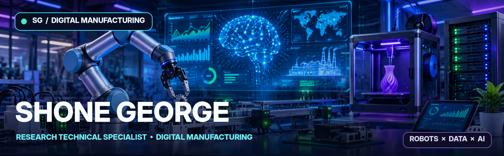
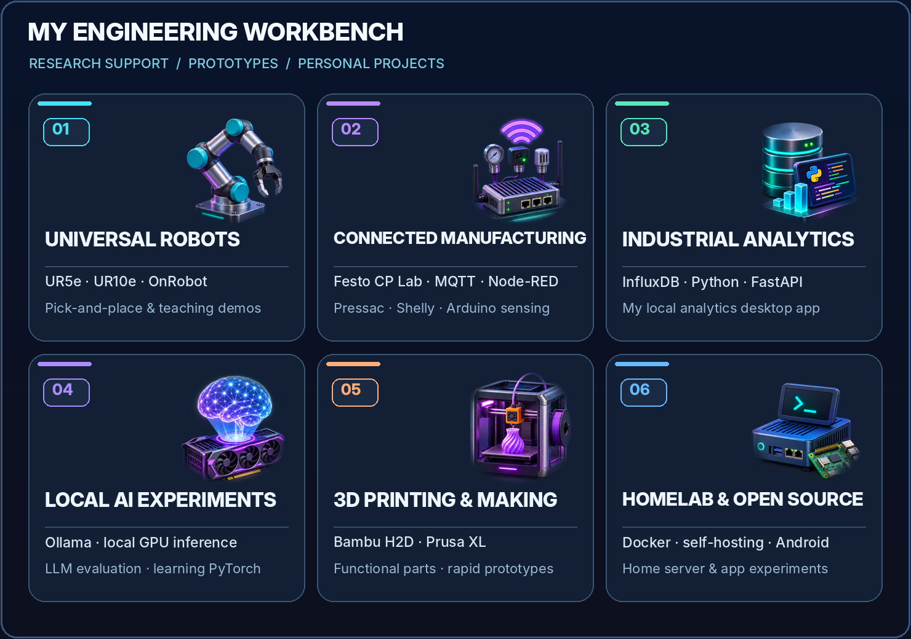
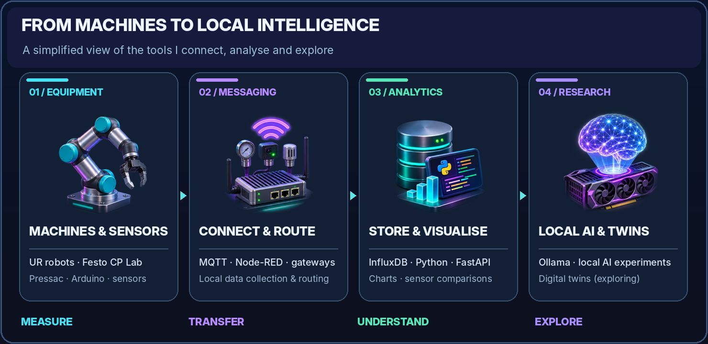

  

  
  
  

<h3 align="center">I turn machines into data, data into insight, and ideas into working engineering systems.</h3>

I'm a **Research Technical Specialist in Digital Manufacturing** at Coventry University. My work sits where **robotics, automation, connected machines and practical AI** meet. I enjoy bringing real equipment online, understanding its signals, and turning the results into useful tools, prototypes and demonstrations.

> **My engineering approach:** start with a real problem, build a working prototype, make the data understandable, and keep systems local when it makes sense.

## 🛰️ What I work on

## 🧠 How I connect machines, data and AI

## 🔧 Things I've been building

| Workstream | What it means in practice | Current direction |
|:---|:---|:---|
| **Local Industrial Intelligence** | A local desktop analytics application using **Python, FastAPI, pywebview and InfluxDB** to make industrial data easier to explore. | Active prototype |
| **Robotics & automation demonstrators** | Working with **Universal Robots UR5e / UR10e**, tooling and pick-and-place experiments for teaching and research. | Hands-on lab work |
| **Connected sensing** | Bringing measurements from **Arduino UNO R4 WiFi**, sensors, **MQTT** and **Node-RED** into usable data flows. | Hands-on prototypes |
| **AI close to the machines** | Running **local LLMs via Ollama**, and developing my understanding of model evaluation and **PyTorch**. | Active experiments |
| **Digital twins & industrial software** | Working with ideas around **Asset Administration Shell / Eclipse BaSyx**, edge systems and software-defined PLC approaches. | Applied research interest |
| **Making & open source** | **Bambu Lab H2D**, **Prusa XL**, a self-hosted homelab and useful open-source Android tools. | Ongoing builds |

## 🧰 My everyday toolkit

**Software & data**  
`Python` `FastAPI` `pywebview` `JavaScript` `HTML/CSS` `MQTT` `Node-RED` `InfluxDB` `Docker` `Git` `GitHub`

**Machines & embedded systems**  
`Universal Robots` `Festo CP Lab` `Arduino UNO R4 WiFi` `ESP32` `Industrial gateways` `3D printing`

**AI & emerging interests**  
`Ollama` `Local LLMs` `PyTorch` `Time-series forecasting` `Digital twins` `Eclipse BaSyx` `OpenPLC`

## 🚧 On my workbench

- **A better industrial analytics experience:** clearer charts, sensor comparisons and useful explanations — not just data logging.
- **Smarter machines at the edge:** connecting sensing, manufacturing equipment and local intelligence responsibly.
- **Robotics that demonstrates something real:** practical automation experiments with clear teaching value.
- **Public open-source projects:** turning smaller software experiments into documented, reusable code.

## 🌱 Beyond the lab

I also enjoy experimenting with **self-hosted services, compact computers, open-source Android apps, 3D-printed designs** and creative ways to visualise information. I like technology that is understandable, useful and fun to tinker with.

---

  <b>MADE TO EXPLORE · BUILT TO LEARN · SHARED WHEN READY</b>

